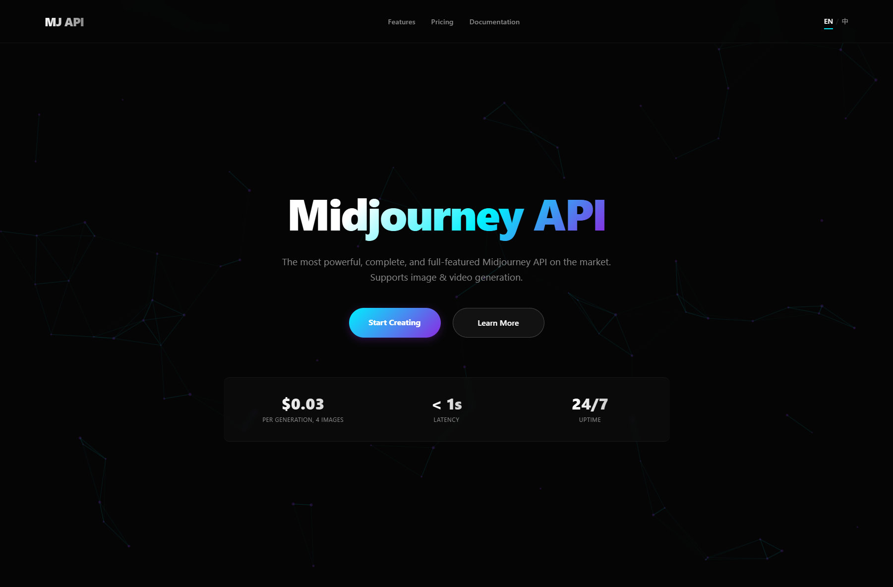
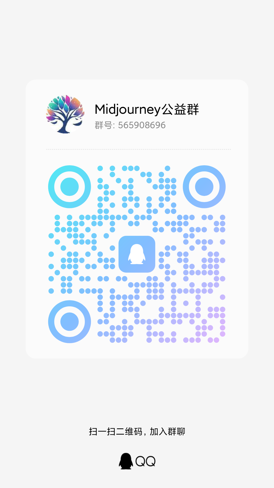
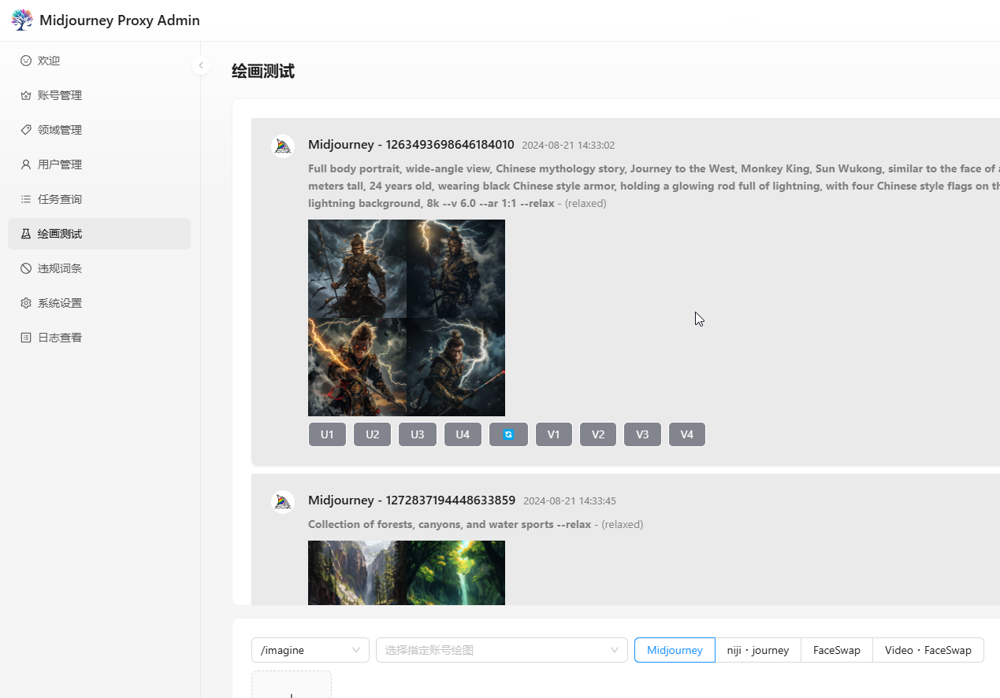

# Midjourney API

A free, open-source Midjourney API that puts Discord, YouChuan and the Midjourney official website behind one HTTP interface, with one-click face swap for images and videos.

The world's largest and most complete free open-source Midjourney API — the most powerful and full-featured, generating 1,000,000+ images per day!

## ⚡ Huanwang AI · Enterprise Midjourney API

**Always-on FAST · 120× ultra-high concurrency · Never banned · Permanent retention · Derivatives available anytime, forever · Native MCP support**

- Website: <https://huanwangai.com>
- API console: <https://api.huanwangai.com>



**English** | [中文](README.zh-CN.md)

## Documentation

- [English manual entry](docs/manual/en/README.md)
- [Chinese manual](docs/manual/index.md)
- [Documentation maintenance & AI generation rules](docs/manual/AGENTS.md)
- [Release archive](docs/manual/appendix/releases.md)
- [API reference](docs/manual/06-api-reference.md)
- [Configuration reference](docs/manual/04-configuration.md)

### Quick start

1. Start the service with the one-click Docker script or the published image (default port `8086`).
2. Open the admin console, sign in, and reset the administrator token immediately.
3. On a private deployment, turn off demo mode, registration and guest access.
4. Add at least one drawing account and wait until it comes online.
5. Submit a minimal drawing request and confirm that the task result comes back.

## ⚡ Discord Official Mirror

All Discord commands supported, ready out of the box: <https://trueai.org>

## Community

If you have questions about usage or deployment, join the community group and work through them together.

If you need drawing capacity, contact a group admin — the group is full of experienced users.

[Midjourney Community Group](https://qm.qq.com/q/k88clCkyMS) (QQ Group: 565908696)



## Backend Integration Guides

- Midjourney official website: <https://trueai-org.feishu.cn/docx/ZDeUdPCBho4IE0xJHxpcXbdYnKd>
- YouChuan: <https://trueai-org.feishu.cn/docx/KrdIdOKm4otVmwxdv3AcLjsEnXf>


## Main Features

- [x] Discord drawing.
- [x] YouChuan drawing.
- [x] Midjourney official website drawing.
- [x] Distributed deployment.
- [x] Online upgrade.
- [x] Online restart.
- [x] Elastic deployment with load balancing and Consul as the configuration center.
- [x] Imagine command and related actions [V1/V2.../U1/U2.../R].
- [x] Base64 reference images when submitting Imagine.
- [x] Blend (image mixing), Describe (image to text) and Shorten (prompt analysis) commands.
- [x] Real-time task progress.
- [x] Chinese prompt translation, configurable through Baidu Translate or GPT.
- [x] Prompt sensitive-word pre-detection with overridable rules.
- [x] User-token WSS connection for error messages and the full command set.
- [x] Focus shift: Pan ⬅️➡⬆️⬇️.
- [x] Partial redraw: Vary (Region) 🖌.
- [x] All associated button actions.
- [x] Image zoom and custom zoom 🔍.
- [x] Retrieve the seed of a generated image.
- [x] Per-account generation speed mode: RELAX | FAST | TURBO.
- [x] Multi-account configuration with a dedicated task queue per account and selectable account strategies: BestWaitIdle | Random | Weight | Polling.
- [x] Persistent account pool with dynamic maintenance.
- [x] Fetch account `/info` and `/settings` details.
- [x] Account settings management.
- [x] Both the niji・journey Bot and the Midjourney Bot.
- [x] Safe compressed transport with zlib-stream <https://discord.com/developers/docs/topics/gateway>.
- [x] Embedded MJ admin console with multi-language support <https://github.com/trueai-org/midjourney-proxy-webui>.
- [x] Create, read, update and delete MJ accounts.
- [x] Detailed account information and account synchronization.
- [x] Per-account concurrency and queue settings.
- [x] Task queries for MJ jobs.
- [x] A complete drawing test page.
- [x] Compatible with mainstream drawing clients and API calls.
- [x] Parent task id in task payload.
- [x] 🎛️ Remix mode and automatic Remix submission.
- [x] Built-in local image storage and built-in CDN acceleration.
- [x] Automatically simulates reading unread messages when too many are pending.
- [x] BOOKMARK and other commands.
- [x] Target a specific instance, filter accounts by speed, filter `remix` accounts and more — see the Swagger `accountFilter` field.
- [x] Reverse-generate task information from a job id or an image.
- [x] Account sorting, parallelism, queue count, max queue size and task interval settings.
- [x] Client path modes: default `https://{BASE_URL}/mj/submit/imagine`, `/mj-turbo/mj` for turbo mode, `/mj-relax/mj` for relax mode, `/mj-fast/mj` for fast mode, `/mj` for no mode.
- [x] CloudFlare manual human verification: the account is locked automatically when triggered, then verified through the GUI or an email notification.
- [x] CloudFlare automatic human verification with a configurable verification server (the auto-verifier only runs on Windows).
- [x] Working-hour windows — drawing around the clock can trigger warnings, so 8–10 hours of rest is recommended, e.g. `09:10-23:55, 13:00-08:10`.
- [x] Built-in IP rate limiting, IP-range limiting, blacklists, whitelists and automatic blacklisting.
- [x] Daily drawing limit; once reached, no new jobs are accepted but variations and redraws still work.
- [x] Registration and guest access toggles.
- [x] Visual configuration.
- [x] Swagger documentation can be exposed independently.
- [x] Bot token is optional — the service works without a bot.
- [x] Improved command and progress display.
- [x] Idle-time configuration with a relaxed ("salted fish") mode per account to avoid high-frequency operation (no new drawings in that window, other commands still work, multiple time windows supported).
- [x] Vertical account categories: each account can be restricted to one kind of work, e.g. landscapes only or portraits only.
- [x] Shared channels and sub-channels: if an account is banned, earlier drawings can continue by using its channel as a sub-channel of a healthy account, with permanent invite and sub-channel links and batch editing.
- [x] SQLite (default), MySQL/MariaDB, PostgreSQL and SQL Server; about 500,000 task records are retained by default (database support sponsored by `@如风`).
- [x] One-click migration from `mjplus` or other services, including accounts and tasks.
- [x] Built-in forbidden-word management with grouped entries.
- [x] Non-official links in prompts are rewritten to official ones, so domestic or custom reference links do not trigger verification.
- [x] When fast hours run out, switch to relax mode automatically (opt-in) and restore fast mode after a top-up or renewal.
- [x] Image storage on Alibaba Cloud OSS with custom CDN, custom styles and thumbnails (OSS is recommended: separated from the origin and faster to load).
- [x] Shorten-based prompt analysis regeneration.
- [x] Image face swap — comply with local laws and never use it for illegal purposes.
- [x] Video face swap — comply with local laws and never use it for illegal purposes.
- [x] Automatic switching between relax and fast mode, plus automatic relax configuration.
- [x] No DM channel id needed — it is fetched automatically at startup.
- [x] Automatic handling of "Tos not accepted".
- [x] 2FA authenticator, e.g. `http://47.76.110.222:8081/code`, details: `http://47.76.110.222:8081/swagger/index.html`.
- [x] Storage backends: Alibaba Cloud OSS, Tencent Cloud COS, local storage, S3 (thanks to `@八级大狂风` for sponsoring) and Cloudflare R2 (no egress fees, see <https://developers.cloudflare.com/r2/>).
- [x] Independent translation configuration for MJ and NIJI.
- [x] Convert Niji to MJ: Niji・journey jobs are submitted to Midjourney with a `--niji` suffix, so the Niji bot is not required.
- [x] Convert `--niji` to the Niji Bot: prompts containing `--niji` are routed to the Niji・journey Bot automatically.
- [x] Automatic account login (enable 2FA on the Discord account <https://github.com/trueai-org/midjourney-proxy/wiki/2FAopen> and configure `YesCaptchaKey` on the login service <https://yescaptcha.com/i/4pizLQ>).
- [x] Account limits, concurrency and validity periods — thanks to `@TOOM` for sponsoring this feature.
- [x] Video generation.
- [x] YouChuan account import from .xlsx (up to 20 MB and 2,000 rows).
- [x] Multiple auth headers: Authorization, mj-api-secret, x-api-key and api-key.
- [x] Redis pipeline for account runtime snapshots.
- [x] HEAD probing for image URL suffix when the URL has a query string or no extension.

## Online Preview

The public endpoint runs in relax mode and is free to call. The account pool is provided by sponsors — please use it responsibly.

- Admin console: <https://ai.trueai.org>
- Access: public demo mode (read-only); no credentials are published.
- Public API: <https://ai.trueai.org/mj>
- API documentation: <https://ai.trueai.org/swagger> (restored after the public demo site is updated; fixed locally — rely on your actual deployment)
- Auto verification / auto login server: `http://47.76.110.222:8081`
- Auto verification / auto login documentation: `http://47.76.110.222:8081/swagger`

> The public verifier has been under heavy malicious attack, so automatic login is currently paused. Deploy your own verifier if you need it.

## Preview Screenshots



## Recommended Clients

- **ChatAny**: <https://github.com/ChatAnyTeam/ChatAny>
  - Get your own ChatGPT + StabilityAI + Midjourney web service in one click: <https://aidemo.xiazai.zip/#/mj>
  - Open the site → Settings → Custom API → Model (Midjourney) → API URL → <https://ai.trueai.org/mj>

- **GoAmzAI**: <https://github.com/Licoy/GoAmzAI>

- **ChatGPT Web Midjourney Proxy**: <https://github.com/Dooy/chatgpt-web-midjourney-proxy>
  - Open <https://vercel.ddaiai.com> → Settings → MJ drawing API URL → <https://ai.trueai.org>

- **GoMaxAI**: <https://github.com/51yuese/GoMaxAI-ChatGPT-Midjourney-Pro>

- **SparkAI**: <https://ai.sparkaigf.com>

## Recommended Providers

- **GPTNB**: <https://goapi.gptnb.ai>
- **Yifeng**: <https://api.ephone.ai>
- **Midjourney API**: <https://api.mjdjourney.cn>

## Installation and Usage

> Note: for a private deployment, always turn off demo mode, registration and guest access so the API cannot be abused.

> Note: on Windows, download the portable package and start it directly — see below.

### Quick Start

> Help: [WIKI](https://github.com/trueai-org/midjourney-proxy/wiki)

> Docker

- [Bilibili: Midjourney API Docker deployment video](https://www.bilibili.com/video/BV1NQpQezEu4/)
- [Douyin: Midjourney API Docker deployment video](https://v.douyin.com/irvnDGfo/)

Note: double-check that the mapped files and paths are correct ⚠

```bash
# Note: the official image needs more memory — 2 GB minimum on the server
# Official image (full: Discord, YouChuan and official website drawing, more dependencies)
# Installs and starts automatically
# The one-click upgrade script is recommended
# 1. First download (edit the script afterwards to customize path, port, memory, etc. — default port is 8086)
wget -O docker-upgrade.sh https://raw.githubusercontent.com/trueai-org/midjourney-proxy/main/scripts/docker-upgrade.sh && bash docker-upgrade.sh

# 2. Upgrade later by running the same script
sh docker-upgrade.sh

# 3. Docker environment variables (optional)
# Max concurrent tasks per node: -e CONCURRENT=10
# Host private IP: -e HOST_IP=10.0.0.1

# 4. Kestrel environment variables (optional)
# KESTREL_MIN_REQUEST_BODY_BYTES_PER_SECOND: minimum request body data rate in bytes per second, default 240, recommended 10 - 1000
# KESTREL_SLOW_BUFFER_SECONDS: allowed buffering time in seconds, default 5, recommended 5 - 30
# KESTREL_MAX_REQUEST_BODY_SIZE: maximum request body size in MB, default 30, recommended 10 - 100
```

> [Docker Compose documentation for all services](https://github.com/trueai-org/midjourney-proxy/wiki/Docker-Compose-Doc)

> [Database / Redis deployment and container networking](https://github.com/trueai-org/midjourney-proxy/wiki/Docker-Doc)

> [Database benchmark report](https://github.com/trueai-org/simple-database-benchmark)

- `Redis`: required, e.g. `mjopen-redis:6379,password=***,defaultDatabase=1,prefix=mjopen:`
- `Sqlite3`: default local database, stored at `data/mj_sqlite.db`
- `MySQL8.4/MariaDB11`: connection string, e.g. `Data Source=mjopen-mysql;Port=3306;User ID=root;Password=***;Initial Catalog=mjopen;SslMode=none;AllowPublicKeyRetrieval=true;Min pool size=1;Default Command Timeout=120;Connection Timeout=30`
- `SQLServer2022/2025`: connection string, e.g. `Data Source=mjopen-sqlserver;User Id=sa;Password=***;Initial Catalog=mjopen;Encrypt=True;TrustServerCertificate=True;Pooling=true;Min Pool Size=1`
- `PostgreSQL16/17/18`: connection string, e.g. `Host=mjopen-postgres;Port=5432;Username=mj;Password=***;Database=mjopen;ArrayNullabilityMode=Always;Pooling=true;Minimum Pool Size=1`

```bash
# Start with docker-compose
# Download docker-compose.yml
wget -O docker-compose.yml https://raw.githubusercontent.com/trueai-org/midjourney-proxy/main/scripts/docker-compose.yml

# Start the container and its services (edit docker-compose.yml first to customize path, port, memory, passwords, etc. — default port is 8086)
# Default: MySQL only
docker compose up -d

# Use PostgreSQL
docker compose --profile postgres up -d

# Use SQL Server (change to a strong password)
docker compose --profile sqlserver up -d

# Start several profiles at once
docker compose --profile postgres --profile sqlserver up -d

# Stop services
docker-compose down

# Follow all service logs
docker-compose logs -f

# Follow a specific service
docker-compose logs -f mjopen
docker-compose logs -f mjopen-redis
docker-compose logs -f mjopen-mysql

# Restart all services
docker-compose restart

# Restart a specific service
docker-compose restart mjopen
```

```bash
# Lite image (Discord and YouChuan drawing only)
docker pull registry.cn-guangzhou.aliyuncs.com/trueai-org/midjourney-proxy:lite
docker pull registry.cn-guangzhou.aliyuncs.com/trueai-org/midjourney-proxy:lite-{version}
```

```bash
# Manual install and start
# Alibaba Cloud image (recommended in mainland China)
docker pull registry.cn-guangzhou.aliyuncs.com/trueai-org/midjourney-proxy

# 1. Business configuration is written to `data/mj.json` by the admin console; no appsettings template download is needed.

# 2. Stop and remove the old container
docker stop mjopen && docker rm mjopen

# 3. Start the container
docker run --name mjopen -d --restart=always \
 -p 8086:8080 --user root \
 -v /root/mjopen/logs:/app/logs:rw \
 -v /root/mjopen/data:/app/data:rw \
 -v /root/mjopen/attachments:/app/wwwroot/attachments:rw \
 -v /root/mjopen/ephemeral-attachments:/app/wwwroot/ephemeral-attachments:rw \
 -e TZ=Asia/Shanghai \
 -v /etc/localtime:/etc/localtime:ro \
 -v /etc/timezone:/etc/timezone:ro \
 registry.cn-guangzhou.aliyuncs.com/trueai-org/midjourney-proxy

# GitHub mirror
docker pull ghcr.io/trueai-org/midjourney-proxy
docker run --name mjopen -d --restart=always \
 -p 8086:8080 --user root \
 -v /root/mjopen/logs:/app/logs:rw \
 -v /root/mjopen/data:/app/data:rw \
 -v /root/mjopen/attachments:/app/wwwroot/attachments:rw \
 -v /root/mjopen/ephemeral-attachments:/app/wwwroot/ephemeral-attachments:rw \
 -e TZ=Asia/Shanghai \
 -v /etc/localtime:/etc/localtime:ro \
 -v /etc/timezone:/etc/timezone:ro \
 ghcr.io/trueai-org/midjourney-proxy

# Docker Hub mirror
docker pull trueaiorg/midjourney-proxy
docker run --name mjopen -d --restart=always \
 -p 8086:8080 --user root \
 -v /root/mjopen/logs:/app/logs:rw \
 -v /root/mjopen/data:/app/data:rw \
 -v /root/mjopen/attachments:/app/wwwroot/attachments:rw \
 -v /root/mjopen/ephemeral-attachments:/app/wwwroot/ephemeral-attachments:rw \
 -e TZ=Asia/Shanghai \
 -v /etc/localtime:/etc/localtime:ro \
 -v /etc/timezone:/etc/timezone:ro \
 trueaiorg/midjourney-proxy
```

> Windows (ARM builds are no longer supported)

```bash
a. Download the latest portable build for Windows from https://github.com/trueai-org/midjourney-proxy/releases, e.g. midjourney-proxy-win-x64.zip
b. Extract it and run Midjourney.API.exe
c. Open http://localhost:8080
d. (Optional) Deploy to IIS: add the folder as a website, set the application pool to "No Managed Code" and start the site.
e. (Optional) Use the built-in Task Scheduler to create a basic task that runs the .exe, and choose "Do not start a new instance" so only one instance runs.
```

> Linux (ARM builds are no longer supported)

```bash
a. Download the latest portable build for Linux from https://github.com/trueai-org/midjourney-proxy/releases, e.g. midjourney-proxy-linux-x64.zip
b. Extract it in the current directory: tar -xzf midjourney-proxy-linux-x64-<VERSION>.tar.gz
c. The entry point is run_app.sh
c. Start method 1: sh run_app.sh
d. Start method 2: chmod +x run_app.sh && ./run_app.sh
```

> macOS (ARM builds are no longer supported)

```bash
a. Download the latest portable build for macOS from https://github.com/trueai-org/midjourney-proxy/releases, e.g. midjourney-proxy-osx-x64.zip
b. Extract it in the current directory: tar -xzf midjourney-proxy-osx-x64-<VERSION>.tar.gz
c. The entry point is run_app_osx.sh
c. Start method 1: sh run_app_osx.sh
d. Start method 2: chmod +x run_app_osx.sh && ./run_app_osx.sh
```

> Linux one-click install script (❤ thanks to [@dbccccccc](https://github.com/dbccccccc))

```bash
# Method 1
wget -N --no-check-certificate https://raw.githubusercontent.com/trueai-org/midjourney-proxy/main/scripts/linux_install.sh && chmod +x linux_install.sh && bash linux_install.sh

# Method 2
curl -o linux_install.sh https://raw.githubusercontent.com/trueai-org/midjourney-proxy/main/scripts/linux_install.sh && chmod +x linux_install.sh && bash linux_install.sh
```

## Paths

- `/app/data` — data directory for accounts, tasks and other state
  - `/app/data/mj.json` — configuration file
- `/app/logs` — log directory
- `/app/wwwroot` — static files
  - `/app/wwwroot/attachments` — generated drawings
  - `/app/wwwroot/ephemeral-attachments` — images produced by describe

### Roles

- `Regular user`: drawing API only, cannot sign in to the console.
- `Admin`: can sign in to the console, inspect tasks and change settings.

### Default User

- Inject a strong administrator token through `AdminToken` before first startup; rotate it immediately after the first login.

### Alibaba Cloud OSS Configuration

```json
{
  "bucketName": "mjopen", // OSS bucket name
  "accessKeyId": "LTAI***", // OSS access key id
  "accessKeySecret": "<YOUR_OSS_SECRET>", // OSS access key secret
  "endpoint": "oss-cn-hongkong-internal.aliyuncs.com", // OSS endpoint
  "customCdn": "custom CDN domain",
  "imageStyle": null,
  "thumbnailImageStyle": null,
  "videoSnapshotStyle": null,
  "expiredMinutes": 0
}
```

### Face Swap Configuration

- Register on the official site and copy the token: https://replicate.com/cdingram/face-swap

```json
{
  "token": "****",
  "enableFaceSwap": true,
  "faceSwapVersion": "d1d6ea8c8be89d664a07a457526f7128109dee7030fdac424788d762c71ed111",
  "faceSwapCoreSize": 3,
  "faceSwapQueueSize": 10,
  "faceSwapTimeoutMinutes": 10,
  "enableVideoFaceSwap": true,
  "videoFaceSwapVersion": "104b4a39315349db50880757bc8c1c996c5309e3aa11286b0a3c84dab81fd440",
  "videoFaceSwapCoreSize": 3,
  "videoFaceSwapQueueSize": 10,
  "videoFaceSwapTimeoutMinutes": 30,
  "maxFileSize": 10485760,
  "webhook": null,
  "webhookEventsFilter": []
}
```

### Banned Prompt Rate Limiting

- Configures how long (in minutes) a user is blocked after `Banned prompt detected` is triggered `n` times in one day. Whitelisted users are excluded.

```json
{
  "enable": true,
  "rules": {
    "1": 60,
    "2": 120,
    "3": 600
  }
}
```

### Bot Token (optional)

The bot token is used to connect to Discord over WSS and gives you error messages and the full feature set.

[Bot token configuration guide](./docs/en/api.md)

## Development

Requirements: .NET 8 SDK; the solution targets `net8.0`.

```bash
# Restore and build
dotnet restore Midjourney.sln
dotnet build Midjourney.sln

# Run the API (Development profile)
dotnet run --project src/Midjourney.API/Midjourney.API.csproj

# Run the tests
dotnet test src/Midjourney.Tests/Midjourney.Tests.csproj
```

- Logs are written to the `logs` directory next to the executable; inside the container they go to `/app/logs`.
- With the Development profile the console and Swagger UI are served on `http://localhost:5229`; in Docker the service listens on `8080`, mapped to `8086` by the commands above.

## CloudFlare CAPTCHA Verification

Free automatic CAPTCHA handling. Example CloudFlare auto-verification configuration:

- `CaptchaServer`: address of the verification server.
- `CaptchaNotifyHook`: callback fired when verification completes; defaults to your domain.

```json
"CaptchaServer": "http://47.76.110.222:8081",
"CaptchaNotifyHook": "https://ai.trueai.org"
```

## CloudFlare Verifier / Auto Login

Windows only (TLS 1.3 supported; requires Windows 11 or Windows Server 2022). The verifier drives Chrome, so it has to run on Windows — a Linux deployment would need too many extra libraries.

Recommended: <https://yescaptcha.com/i/4pizLQ>

Note: 2captcha is currently unstable. Self-hosting requires a 2captcha.com API key, otherwise it will not work. Pricing: 1000 verifications / 9 CNY, site: <https://2captcha.cn/p/cloudflare-turnstile>.

Tip: the first startup downloads Chrome, which can take a while.

> Sample verifier `appsettings.json` (verifier service configuration, not the main application configuration)

```json
{
  "Captcha": {
    "IsLoginService": true, // enable the login service
    "Concurrent": 1, // concurrency
    "Headless": true, // run Chrome headless
    "TwoCaptchaKey": "", // 2captcha.com API key
    "YesCaptchaKey": "" // yescaptcha.com API key
  },
  "urls": "http://*:8081" // default port
}
```

## Preventing Warning on Frequent Drawing

- Keep the task interval between 30 and 180 seconds, with at least 3.6 seconds before execution.
- At most 200 images per day.
- Recommended working hours: 09:10–22:50.
- With multiple accounts, enable vertical categories so each account only produces one kind of work.

## Consul Configuration

Technical layout

> Caddy -> [Yarp | Traefik] -> Midjourney API -> Consul <-> [Yarp | Traefik]

Multiple nodes share the same Redis; Consul serves as the configuration center and for service discovery; the gateway can be YARP or Traefik. Node IPs, ports and tokens depend on the deployment environment.

```bash

# Stop and remove the old container
docker stop consul && docker rm consul

# Host network (sample node address: 192.168.3.241)
docker run -d --name consul --restart always --network host hashicorp/consul agent -server -ui -node=server-1 -bootstrap-expect=1 -client=0.0.0.0 -bind=192.168.3.241

# Port mapping
docker run -d --name consul --restart always -p 8500:8500 -p 8600:8600/udp hashicorp/consul agent -server -ui -node=server-1 -bootstrap-expect=1 -client=0.0.0.0 -bind=0.0.0.0
```

## S3 - MinIO

https://min.io/docs/minio/linux/reference/minio-mc-admin/mc-admin-user.html

> Example

```bash
# Start the container
docker run -d -p 9000:9000 -p 9001:9001 \
  --name minio-test \
  -e "MINIO_ROOT_USER=<YOUR_MINIO_USER>" \
  -e "MINIO_ROOT_PASSWORD=<YOUR_MINIO_PASSWORD>" \
  quay.io/minio/minio:latest server /data --console-address ":9001"

# Set an mc alias that points to your MinIO service first.
mc alias set myminio http://192.168.3.241:9000 "<YOUR_MINIO_USER>" "<YOUR_MINIO_PASSWORD>"

# Verify
mc ls myminio

# Create the test bucket if it does not exist
mc mb myminio/test

# Allow anonymous read-only access
mc anonymous set download myminio/test
```

## Image Acceleration Notes (Reference Only)

How do you choose the right acceleration for different client needs?

Test tool: https://boce.aliyun.com/detect/http

- Users in mainland China: a domestic CDN is the fastest, most stable and cheapest option.
- Users abroad: a global CDN is faster, more stable and cheaper.

```
Midjourney CDN, behind the CloudFlare firewall, ~3s on average, may time out
https://cdn.midjourney.com/4872b862-7aeb-4346-a87d-16e077a2935d/0_2.png

Origin acceleration via OSS bucket (0.5 CNY/GB), 2s ~ 3s on average, may time out
https://mjopen.oss-cn-hongkong.aliyuncs.com/attachments/4872b862-7aeb-4346-a87d-16e077a2935d/0_2.png

Transfer acceleration (global CDN, 1 TB/126 CNY, reachable at home and abroad, slightly slower in mainland China), 1s ~ 3s on average, usually responds
https://mjcdn.googlec.cc/attachments/4872b862-7aeb-4346-a87d-16e077a2935d/0_2.png

Transfer acceleration (domestic CDN, 1 TB/126 CNY, fastest in mainland China), 30ms ~ 200ms on average
https://mjcn-midjourney.googlec.cc/attachments/4872b862-7aeb-4346-a87d-16e077a2935d/0_2.png

Transfer acceleration (0.5 ~ 1.25 CNY/GB, dynamic acceleration, not CDN nodes), 150ms ~ 500ms on average
https://mjopen.oss-accelerate.aliyuncs.com/attachments/4872b862-7aeb-4346-a87d-16e077a2935d/0_2.png

Tencent Cloud EdgeOne, free plan, unlimited traffic, test only, 300ms ~ 1s on average
http://img.aitop3000.com/attachments/4872b862-7aeb-4346-a87d-16e077a2935d/0_2.png

Other options: a proxy, self-hosted storage, local storage, etc.
```

## Support and Sponsorship

- If this project helps you, please give it a Star ⭐.
- You can also donate an idle drawing account (one relax queue) to support the project 😀.
- For ideas and feedback, open a PR, an Issue or a Discussion, or join the QQ group.

## Sponsors

Many thanks to the sponsors and community members for their help and support!

<a href="https://huanwangai.com" target="_blank">HuanWang AI</a>
<a href="https://goapi.gptnb.ai"></a>
<a href="https://d.goamzai.com" target="_blank"></a>
<a href="https://api.ephone.ai" target="_blank">https://api.ephone.ai</a>
<a href="https://www.bzu.cn" target="_blank">https://www.bzu.cn</a>
<a href="https://api.mjdjourney.cn" target="_blank">https://api.mjdjourney.cn</a>
<a href="https://ai.midjourneye.com" target="_blank"></a>

## Security Policy

> Some open-source authors have faced legal consequences, so this project must not be used for illegal purposes.

- Follow national laws. Any illegal use is the sole responsibility of the user.
- This project is released under the GPL. Personal and commercial use are allowed, but permission from the author is required and copyright notices must be kept.
- Follow local laws and regulations; do not use it for illegal purposes.
- Do not use it for illegal activities.

## Star History

[](https://star-history.com/#trueai-org/midjourney-proxy&Date)
