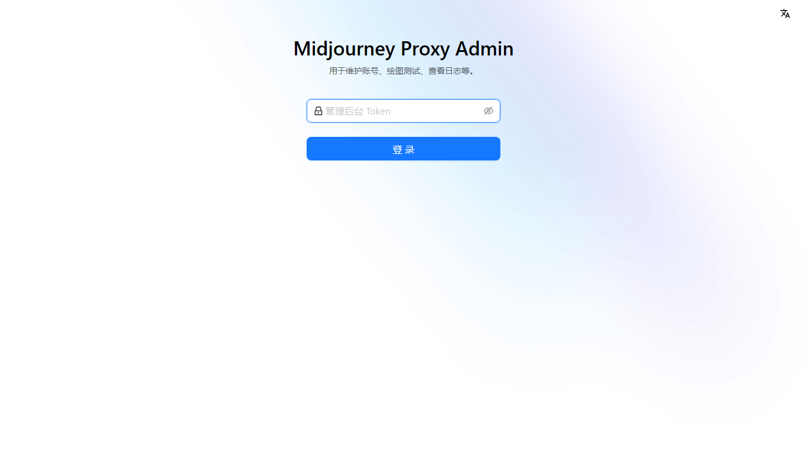
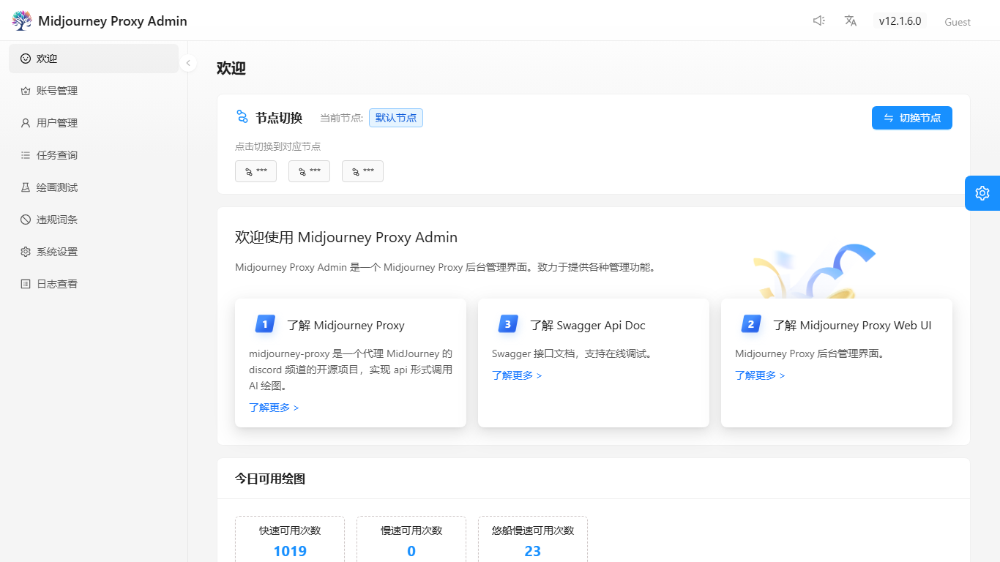
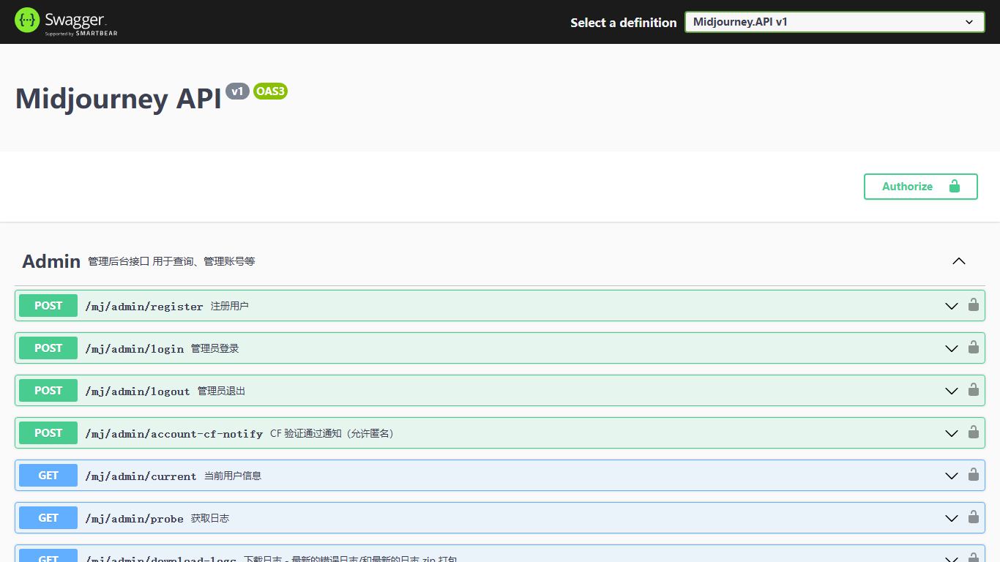
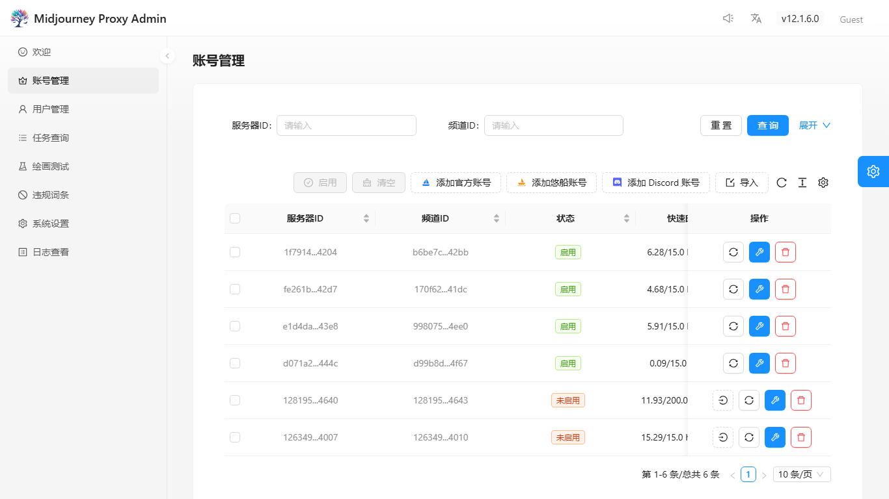
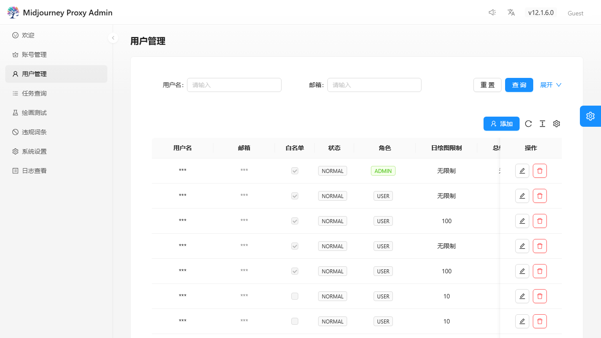
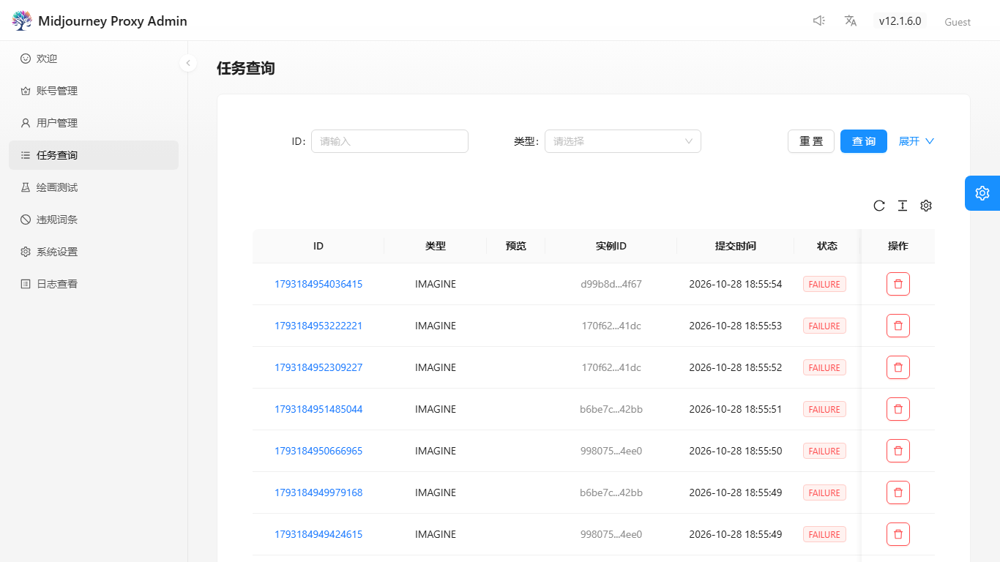
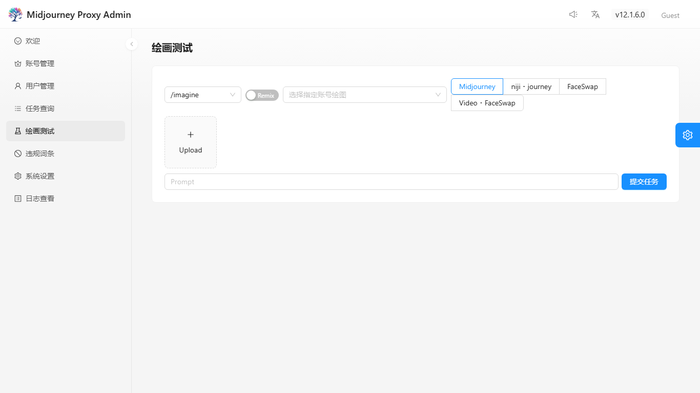
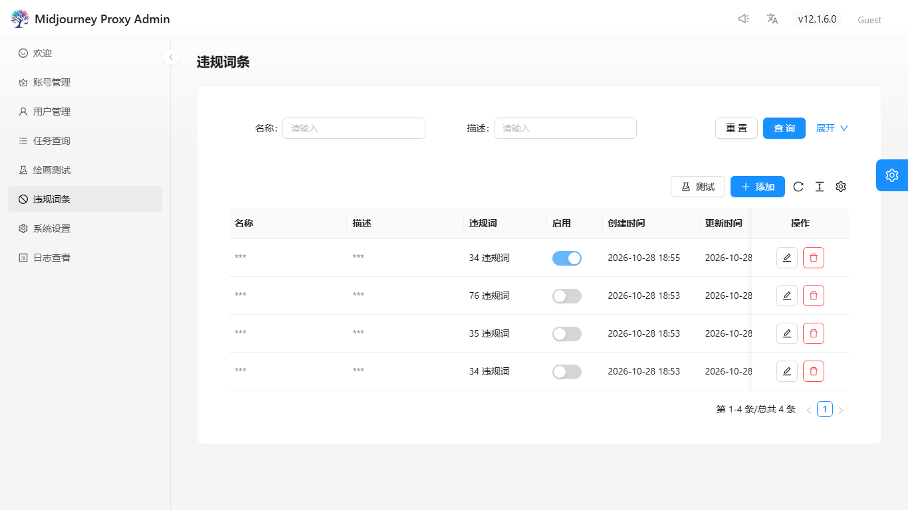
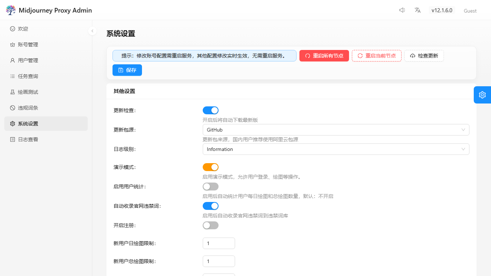
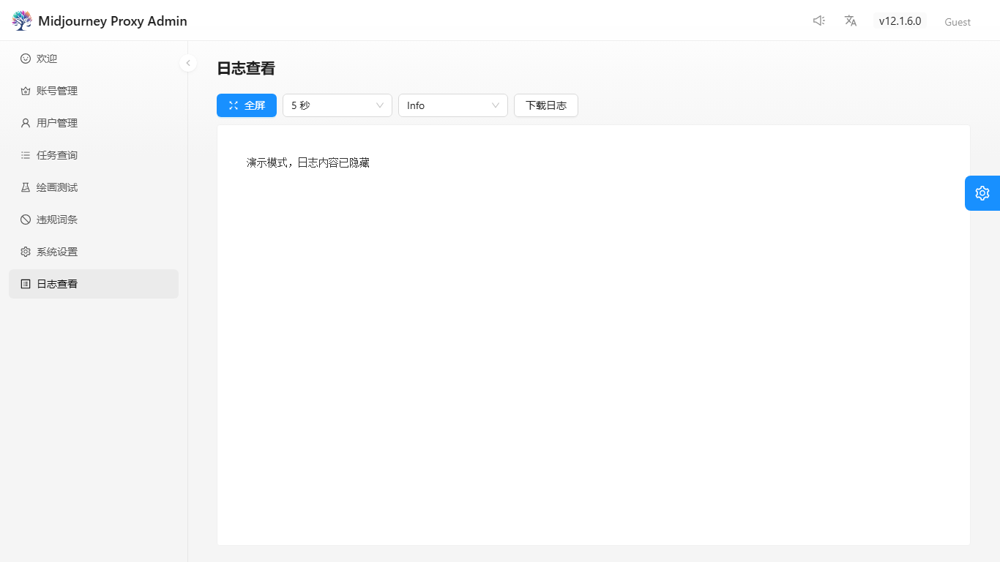

# 07 管理后台

- **适用版本**：v12.1.6
- **适用读者**：使用管理后台进行日常操作的管理员
- **前置条件**：已获得管理员凭据，并能通过浏览器访问管理后台地址

本章按页面顺序介绍管理后台的功能：登录、欢迎页、账号管理、用户管理、任务查询、绘画测试、违规词条、系统设置与日志查看。每个页面只说明用途、关键字段与操作影响，具体配置项含义请对照第四章。

后台使用 hash 路由，页面入口如下：

| 页面 | 路由 | 主要用途 |
| --- | --- | --- |
| 登录 | `#/user/login` | 用管理员 Token 换取登录态 |
| 欢迎 | `#/welcome` | 运行概览、节点切换、快捷入口 |
| 账号管理 | `#/account` | 账号池维护、导入、同步与重连 |
| 用户管理 | `#/user-list` | 用户、额度、角色与 Token |
| 任务查询 | `#/task` | 全量任务检索与结果查看 |
| 绘画测试 | `#/draw-test` | 在后台直接发起与跟踪绘图 |
| 违规词条 | `#/banned-word` | 词库维护与违规词测试 |
| 系统设置 | `#/setting` | 分组配置、保存、重启与更新 |
| 日志查看 | `#/probe` | 实时日志、错误过滤与下载 |

## 登录

### 登录入口与凭据

打开后台会进入登录页，页面只有一个密码输入框，填入管理员 Token 即可。Token 由管理员在用户管理中维护，不能使用普通用户或访客身份进入；首次登录后必须立即重置管理员 Token，不要继续使用初始化凭据。

登录成功后，后端返回 `code: 1` 与 `apiSecret`，前端把它写入 `sessionStorage`，后续请求统一以 `mj-api-secret` 头携带。演示模式下允许空令牌进入只读界面，但写操作仍会被后端拒绝。

页面底部可能出现“注册账号”入口，仅在实例开启注册且已配置邮件服务时显示。通过邮件注册的新用户默认是普通 `USER`，不能进入管理后台（演示模式除外）。

### 登录态与退出

登录态只保存在当前标签页的 `sessionStorage`：关闭标签页或清理浏览器存储后需要重新登录。退出登录会调用 `/mj/admin/logout` 并清除本地 `apiSecret`。接口返回 401 时前端会提示并跳回 `#/user/login`；403 表示账号已过期或不可用；管理员鉴权失败通常是 401。

### 无法登录的排查方向

- 确认 Token 对应的是 `ADMIN` 角色，且用户状态为正常；普通用户会收到“用户无权限”。
- 确认 Token 没有被重置或删除；重置后旧 Token 立即失效。
- 确认反向代理没有丢弃 `mj-api-secret` 或 `Authorization` 请求头。
- 确认浏览器没有禁用 `sessionStorage`，也没有在无痕窗口中丢失登录态。
- 演示模式下空 Token 只能进入只读界面，不能据此判断生产登录是否正常。

## 欢迎页

### 运行概览

欢迎页把运行状态拆成多个卡片，能取到数据的区块才显示，缺数据时自动隐藏。顶部介绍卡提供项目仓库、Swagger 与管理后台仓库入口；存在注册节点时，页面顶部会出现节点切换卡。

- 今日可用绘图：快速可用次数、慢速可用次数（`-1` 显示为无限）、悠船慢速可用次数。
- 实时并发与队列：快速并发/队列、悠船慢速并发/队列、图生文并发/队列、悠船图生文额度；数据读取失败（如 Redis 未启用）时整块隐藏。
- 今日结果：按速度和动作拆分的成功、失败、取消统计。
- 系统运行统计：今日错误数与警告数。
- 系统信息：程序启动时间、运行时长、目录、内存、操作系统、主机名、私网 IP、CPU、进程数与容器环境。
- 绘图趋势：今日、昨日、总绘图量，以及今日绘图客户端 Top IP。

统计缓存约 10 分钟，实时并发与队列约 10 秒刷新一次，因此短时间内的数字可能滞后。

### 快捷入口

- “了解更多 Midjourney Proxy”与“了解更多 Midjourney Proxy Web UI”跳转到对应仓库。
- “了解更多 Swagger Api Doc”打开当前实例的 `/swagger`，用于在线调试接口；仅在开发环境、演示模式或开启 Swagger 时可用。
- 存在注册节点时，可按节点名称切换；切换会跳转到 `/ip/{节点}/`，默认节点为根路径。
- 快捷入口只做跳转，不会修改任何配置。

> Swagger 截图取自本地同版本实例（源码已修复）；线上演示站尚未部署最新修复时仍可能返回 500，部署更新后恢复。详见[截图说明](images/README.md#swagger-截图来源)。

## 账号管理

### 账号列表与筛选

账号管理用表格展示账号池，支持按 `guildId`、`channelId`、状态、备注筛选，默认折叠搜索区。常用列包括：`guildId`、`channelId`（带账号类型图标）、状态、快慢速剩余时间、允许模式、今日成功绘图、今日成功同步、续费日、备注、禁用原因、创建时间与操作。

状态列会叠加多个标签：未运行、风控解锁时间、锁定、运行中任务数、队列数、自动登录中。判断账号是否真正可用时，不能只看“启用/禁用”，还要看是否运行、是否锁定、是否在风控期。

### 新增与编辑账号

工具栏提供“添加官方账号”“添加悠船账号”“添加 Discord 账号”三个入口，按类型弹出不同表单。账号凭据、频道 ID、子频道、备注、权重、并发/队列、允许模式等字段按账号类型填写；保存前先确认账号类型，类型选错会导致连接方式与选号策略都不匹配。

列表中的备注、频道 ID 等字段可直接用于筛选。账号信息弹窗用于查看详情；修改关键连接参数后，需要按下一节的方式重连才能让运行中的实例生效。

### 账号启用、禁用与重连

- 批量启用：勾选账号后点击“批量启用”，只会处理当前处于禁用状态的账号，已启用的会被忽略。
- 清空选择：只清空勾选，不影响账号。
- 登录取 Token：使用账号已保存的账号/密码/2FA 重新获取 Token；缺失时先编辑账号。
- CF 解锁：账号处于锁定状态时可用，按弹窗提示完成 Cloudflare 人机验证。
- 同步：拉取账号当前信息与设置，适合刷新剩余额度、订阅状态等。
- 更新并重连：保存修改并让运行中的实例重新连接，适合改频道、代理、并发等需要立即生效的参数。
- 删除：从账号池移除，运行中的任务可能失败，操作前先确认没有依赖该账号的排队任务。

只“保存”而不重连时，部分账号池参数要等到下次启动或重连才完全生效；Redis 队列容量等状态尤其如此。

### 批量导入入口

导入弹窗当前只开放悠船账号页签，Discord 与 Midjourney 官方页签为占位状态。仅支持 `.xlsx`，文件大小不超过 20MB。

流程是：选择文件后先预览，逐行标记“新增 / 更新 / 无效”；无效行（缺少虚拟号或 SmsCode、文件内重复）不可勾选；确认后只提交勾选行。可选参数包括快速与慢速的并发、队列、日限额，以及权重、超时、混合与图生文开关。

重复虚拟号会更新已有账号的凭据与账号池参数，而不是新建重复账号。导入结果会显示新增、更新、失败数量；失败的账号会给出前几条原因。导入完成后建议抽查账号状态，并对需要立即生效的账号执行“更新并重连”。

## 用户管理

### 用户列表

用户管理展示名称、邮箱、是否白名单、状态、角色、日限额、总限额、今日已用与总已用次数。支持按名称、邮箱、状态、角色筛选；新增、编辑、删除都在行内或工具栏完成。

### 用户额度与权限

- 白名单用户不受限流与配额约束，授予前确认业务必要性。
- 日限额、总限额为 `0` 或负数时表示不限制；具体口径以表单提示为准。
- 并发数与队列数控制单个用户的同时执行与排队上限。
- 角色只有 `USER` 与 `ADMIN`；只有 `ADMIN` 能进入管理后台，`USER` 只能调用绘图接口。
- Token 是用户调用接口的凭据，可一键生成随机值。重置后旧 Token 失效，需要把新值交给调用方。
- 有效期字段控制账号可用时间；不在有效期内时接口返回 403「账号不可用」。

### 用户状态维护

禁用用户会阻止其继续调用接口；删除用户会移除记录，历史任务不会被一并删除。删除或重置前先确认没有业务仍在用该 Token。管理员账号的 Token 与角色变更影响最大，建议单独记录变更时间。

## 任务查询

### 任务列表与筛选

任务查询展示全量任务，顶部“用户统计”卡片汇总总记录数、总消耗数与各动作数量。搜索区支持按动作、状态、模式、提交时间范围、用户 ID、是否第三方任务筛选。

常用列包括：任务 ID、动作类型、缩略图/视频预览、实例（`discordInstanceId`）、提交时间、状态、模式、进度、耗时、描述与失败原因。状态用颜色区分：执行中、成功、失败、取消、弹窗等待等。第三方任务会在 ID 旁标记“外”。

### 任务详情

点击任务 ID 打开详情弹窗，可查看完整提示词、实例、动作、状态、进度、时间、失败原因与扩展属性。排查失败任务时，先看 `failReason`，再对照账号状态与提交时间。

### 任务结果文件

缩略图可预览原图；视频任务显示播放按钮并在弹窗中播放。图片前缀由 `current` 接口下发并保存在 `sessionStorage`，用于拼接相对地址。删除任务只删除记录，不会删除已经生成的外部文件；删除前确认不需要留档。

## 绘画测试

### 发起测试任务

绘画测试页用于在后台直接验证账号与链路，支持 `/imagine`、`/blend`、`/describe`、`/shorten` 与 `/show task_id`。顶部可选择动作、账号、机器人类型，并用 Remix 开关控制是否走 Remix。

- 账号下拉会列出账号，但未启用或未运行的选项不可选，便于定位具体实例。
- 机器人类型支持 Midjourney、niji・journey、FaceSwap 与 Video・FaceSwap；换脸类型走换脸接口。
- 上传支持 jpg、png、webp 与 mp4，单文件小于 10MB，最多 5 张图片；混合至少 2 张。
- 提交后会显示排队提示（`code: 22`）或直接进入任务列表。

### 查看测试结果

页面初始加载最近几条测试任务，存在未完成任务时每 2 秒轮询一次，任务进入成功、失败或取消后停止。任务卡会展示进度、结果图与可执行按钮（U、V、变体、缩放、平移等）。

点击按钮时，如果返回 `code: 21`，说明需要二次确认：页面会弹出提示词编辑框，局部重绘还会显示涂抹画布。需要注意，当前版本后端未使用 `maskBase64`，涂抹蒙版不会真正生效，重绘结果仍以提示词和父任务为准。关闭确认弹窗会取消该 `MODAL` 任务。

## 违规词条

### 词条维护

违规词条列表展示名称、描述、词数、启用状态、创建时间与更新时间，支持新增、编辑、删除。词数以数组长度展示，编辑时用英文逗号分隔多个关键词。停用某条词库后，它不再参与命中判断，但历史记录保留。

### 命中后的处理

点击“测试”打开违规词测试弹窗：输入违规词（支持中英文逗号、分号、换行分隔，去重，单次最多 200 个），可设置提示词模板与并发数。任务按未开始、执行中、通过、违规、失败分类，支持按状态筛选、删除单条、重试失败与清空记录。

“已确认”页签汇总被上游确认的违规词、命中次数、最后确认时间与原因，可用于补充词库。若实例开启官方违规词自动收集，上游返回的违规词会自动加入官方默认词库，仍建议定期人工复核，避免误收常用词。

## 系统设置

### 分组与字段

系统设置按卡片分组，字段较多，修改前先确认所属分组：

| 分组 | 主要内容 |
| --- | --- |
| 账号设置 | Swagger 开关、数据库类型与连接串、Redis、源数据迁移、任务保留上限、账号选择规则 |
| 存储与集成 | ngDiscord、代理、图片存储类型（本地/OSS/COS/R2/S3）及对应凭据、Replicate 换脸配置 |
| 翻译与消息 | 翻译方式、百度/GPT 翻译、SMTP 邮件、号池预警与冷却、绘画通知回调、通知线程数 |
| 验证与风控 | 验证/登录服务地址与回调、回调密钥、风控自动验证、验证码服务 Key、验证次数 |
| 绘图配置 | 官方/悠船/视频开关、视频合成质量、违规词清除、官方 CDN 填充、提示词链接转换、WebP、同步策略、快速时长、Niji 转换、翻译开关 |
| 其他设置 | 更新检查与更新源、日志级别、演示模式、用户统计、官网违禁词自动收录、注册与访客限额、首页 IP/排行、Consul、限流与公告 |
| Discord 配置 | 防撞图机制、自动获取私信、自动验证、中间图保存、Niji Bot 转换、自动登录 |
| 悠船配置 | 官网链接转换、图生文链接转换、失败重试、强制优先慢速与阈值、重启继续、内网下载 |
| 私人定制 | 始终允许放大、合成图自定义路径、自定义返回链接、保持请求速度、官方个性化、速度参数移除、官方账号调查 |

本节截图只展示“其他设置”分组，不包含连接串、密码或第三方凭据等敏感项。

### 保存与生效

页面顶部有“重启所有节点”“重启当前节点”“检查更新”“保存”四个动作。保存后，多数配置实时生效；账号连接相关配置需要重启或重连。启用 Consul 分布式部署时，“重启所有节点”会作用于全部节点，务必先保存并选择低峰期操作。

检查更新会查询并自动下载更新包，需手动重启生效。升级与回滚步骤见第三章与第八章。

### 高风险配置项提示

数据库/Redis/迁移连接串、SMTP 密码、第三方服务 Key、对象存储凭据、Consul Token、验证回调密钥等字段在本文中一律以“已脱敏/占位”描述，不要截图、复制或提交真实值。

修改连接串、存储或消息配置前先备份当前配置与数据；保存后先重启单个节点验证，再滚动重启其余节点。私人定制项只在实例明确启用时出现，不要为了“看起来可用”而随意打开。

## 日志查看（探针）

### 探针入口

“日志查看”页面用于实时观察服务日志，默认读取最近 1000 行。演示模式下接口会返回提示文本而不是日志内容，这是预期行为。

### 日志过滤与检索

- 刷新间隔支持 5 秒、10 秒、30 秒与停止刷新。
- 级别支持 Info 与 Error；排查故障时先切到 Error。
- 支持全屏查看，适合对照时间线。
- “下载日志”会打包最新日志与错误日志为 zip，便于离线分析。

日志量较大时先停止自动刷新，再下载压缩包检索，避免页面滚动丢上下文。日志可能包含账号 ID、频道 ID 等运行信息，对外提供前先脱敏。

### 排障时的使用方式

1. 记录问题发生时间、任务 ID、账号或频道 ID；
2. 在任务查询确认状态与失败原因；
3. 切到 Error 级别，按时间定位异常堆栈；
4. 需要上下文时下载 zip，检索任务 ID 或频道 ID；
5. 处理完成后把结论写回工单，不要把含凭据的原始日志贴到公开渠道。

日志只用于定位问题，不要把它当作审计账本；关键操作仍以任务表、用户表与账号表为准。
